# Ecosys: an artificial-life ecosystem

An evolving world where nothing is told what to be. There is no `Plant`, `Animal` or `Predator` class: every creature descends from one ancestor, **LUCA**, a blob with a sun patch that divides when it has enough energy. A few physical laws (energy, matter, chemistry, inheritance and mutation) do the rest. Hunters, scavengers, mixotrophs, armoured flytraps and wandering grazers appear through selection alone.

You shape the world and its laws, never the creatures: raise land, open hot vents, dim the sun, flood the map. Then watch life respond.

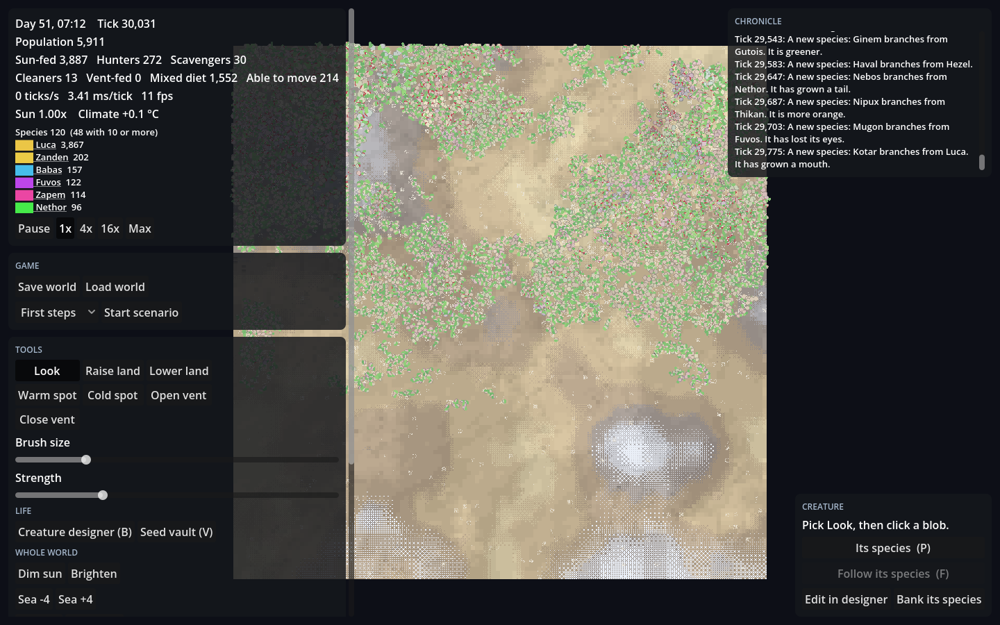

## What's inside

- **Energy is the only currency.** Moving, sensing, thinking, growing and simply existing cost energy. A body that can't take in more than it spends dies. Energy and matter are both audited every interval, so nothing evolves to exploit a leak.
- **Chemistry, not diet genes.** Matter comes in four chemicals, A to D, each at a fixed energy level. Enzymes are genes: photosynthesis is light running A → D uphill, and respiration, digestion and living off vents are all reactions running downhill. What one body gives off is another body's food, or its poison.
- **Bodies built from parts.** Sun patches, mouths, tails, legs, eyes, armour, fat stores and poison, each placed at an angle on the outline (mouths and sun patches can grow on stalks). Every part costs mass and upkeep, and where it sits matters: a mouth only bites what lies in its arc, and armour only guards what it covers.
- **Evolved brains.** Each brain is a small continuous-time recurrent network (CTRNN), with structure and time constants under mutation. Sensors read a field (light, warmth, the dead, loose chemicals, the living, water depth) at a point. The brain drives thrust, turning, the mouth and sleep.
- **A world with places.** A heightmap with slopes, shade, cold nights, climate drift, storms, eruptions, meteors, hot vents and a sea that dims the light with depth.
- **Species are detected, not declared.** Genome distance assigns species at birth, and periodic checks split a species that has drifted into two clusters. Every species gets a procedural name, an entry in the chronicle and a place in the tree of life.
- **Deterministic and fast.** The core is plain C++20 with no engine dependency. Data is stored as one array per field, neighbour queries go through a spatial grid, and every random draw is keyed. The same seed always gives the same world.

## A tour

### The world, up close

Creatures are pixel sprites drawn straight from their genomes: leaves are green, mouths red, armour grey plates, tails wiggle and legs step. Pick any creature to open the inspector: its species, diet, enzymes, energy, body and brain, updated live as it moves.

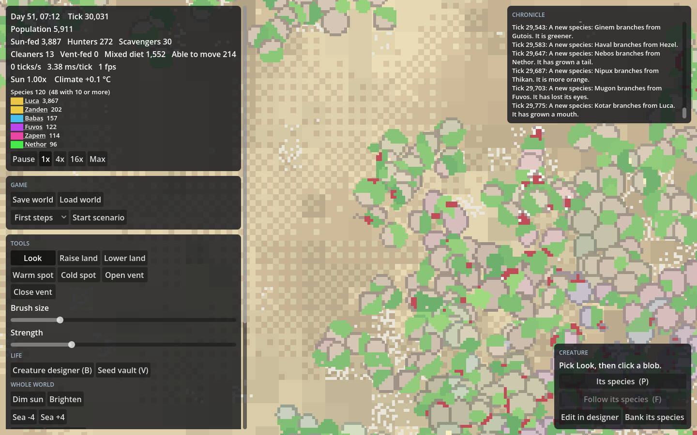

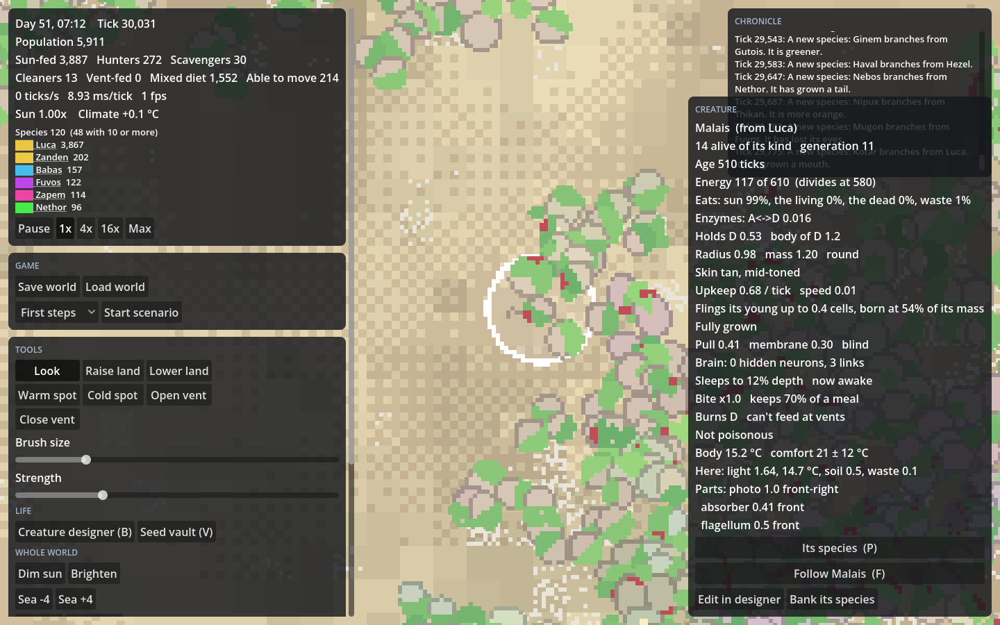

### God powers and overlays

Brushes raise and lower land, warm or chill a spot, and open vents. Global buttons dim the sun or raise the sea. Overlays show temperature, light, nutrients, the dead, loose chemicals, vents and mineral. The world also acts on its own (storms, eruptions, meteors, climate drift) at a rate you set.

| A sea at height 12 | Temperature overlay |
| --- | --- |
| 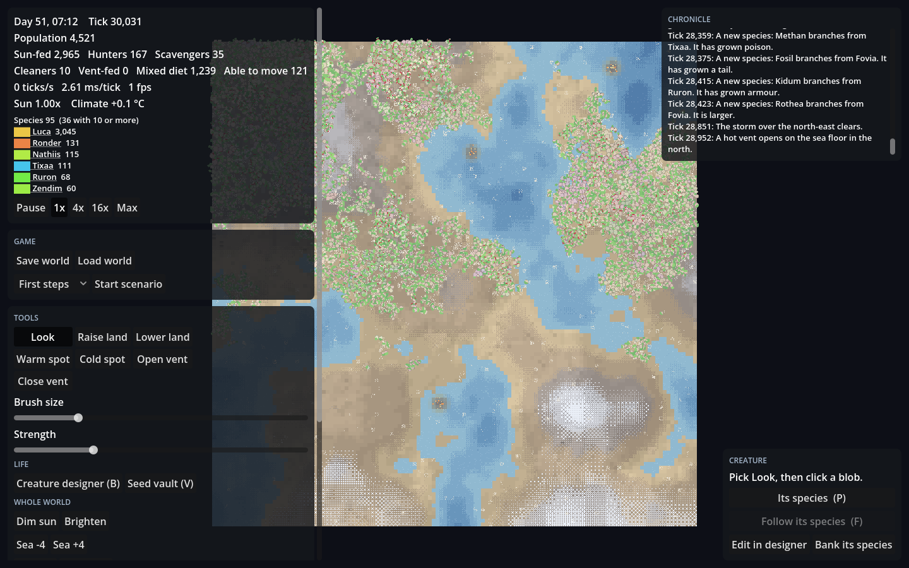 | 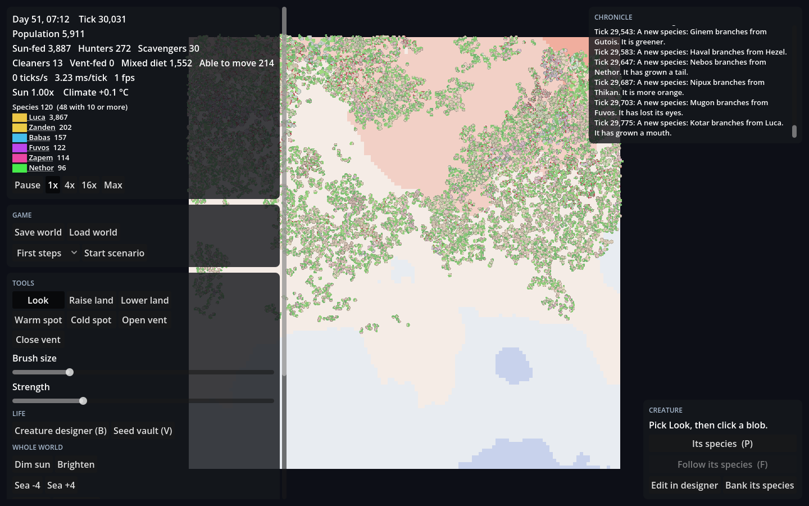 |

### The tree of life and species cards

Every species that took hold, branching in time. Select one to open its card: a living portrait of real members, a niche worked out from what it actually eats, a written natural history, its diet, its body part by part, and its record book.

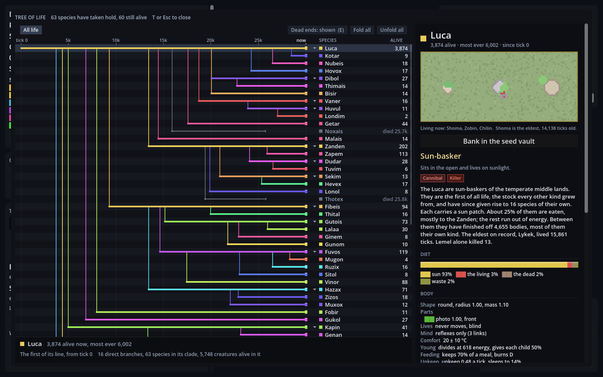

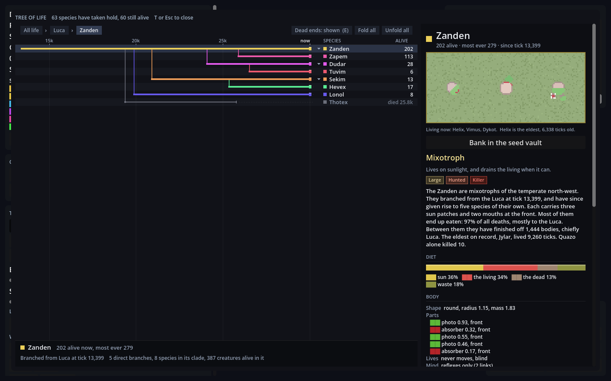

### The food web

Built only from energy that actually moved, with nothing labelled "predator". Sources (sun, the dead, loose chemicals, vents) sit on the left, and each species stands at its measured trophic level. Arrows are coloured by kind of flow: red for draining the living, gold for sunlight, grey for the dead.

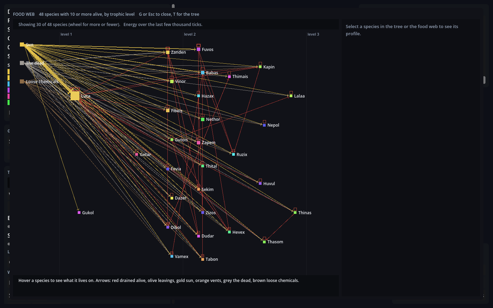

### The creature designer

Build a creature by hand: draw the body, stamp parts on the rim, wire its brain, choose its enzymes, set its life cycle. An energy budget stays in view and gives a verdict at every step (*Thrives*, *Must eat*, *Starves*, ...) with the upkeep bill line by line. Every number comes from the real phenotype compiler.

A design is only a genome. Release it into the world and it becomes an invasive species: it pays its costs under the world's physics, and evolution takes over from its first child.

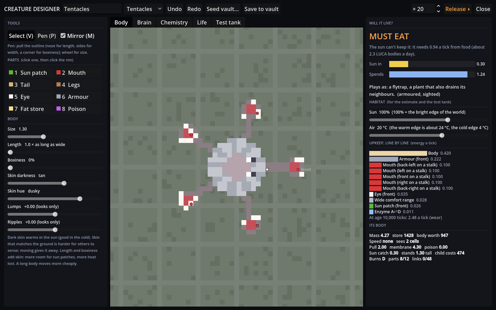

| Brain: senses, hidden neurons, urges | Chemistry: enzymes as genes |
| --- | --- |
| 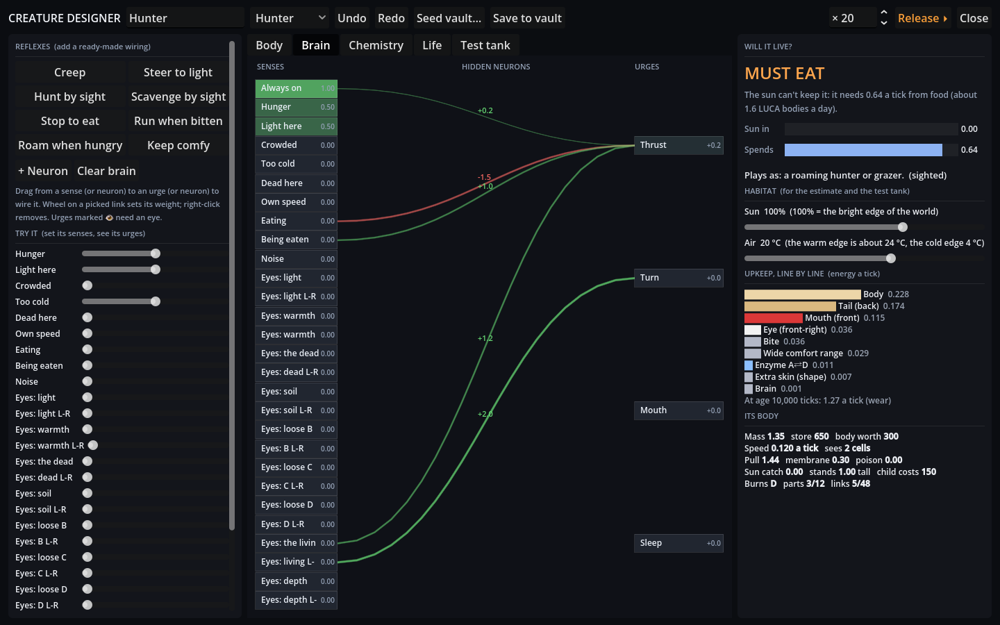 | 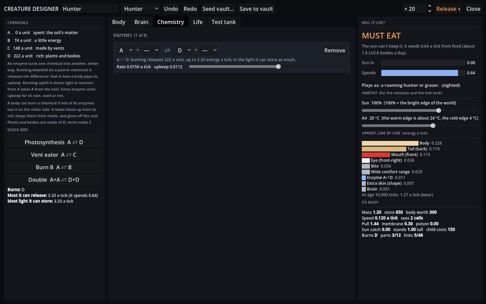 |

The **test tank** drops a dozen of your design into a small world of its own, with or without wild LUCAs, and charts how they fare:

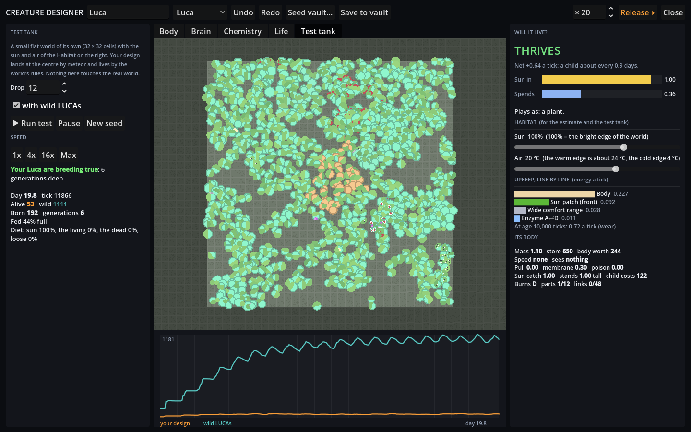

### Body plans

The parade: one hand-made creature of each body plan, drawn by the same shader the world uses.

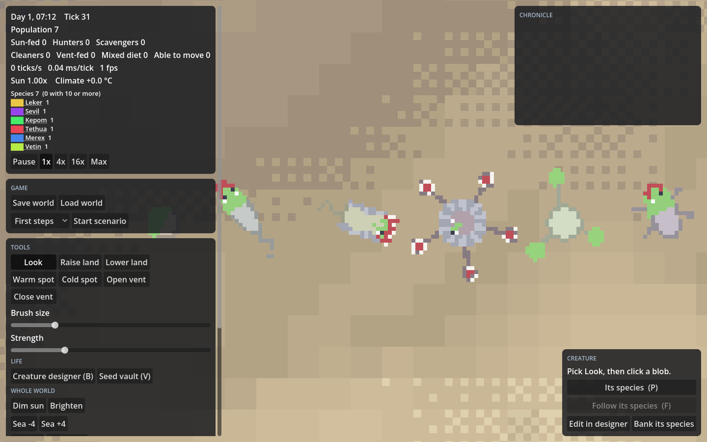

## Building and running

Requirements: CMake 3.20+, a C++20 compiler, Python 3 (with matplotlib for plots). The viewer also needs **Godot 4.7+** and `godot-cpp`. Only macOS is tested so far.

### Headless simulation

```bash
cd luca
cmake -S . -B build -DCMAKE_BUILD_TYPE=Release
cmake --build build -j
./build/luca_headless --ticks 20000 --out out/run1
python3 tools/plot.py out/run1
```

Each run writes metrics (with the energy and matter audits), a chronicle, the tree of life as a table, and a snapshot of every creature. `./build/luca_headless --help` lists every option. Some useful ones:

```bash
./build/luca_headless --ticks 100000 --seed 7 --sea 12 --events 1 --save world.snap
./build/luca_headless --load world.snap --ticks 20000 --set TRANSFER_EFFICIENCY=0.5
./build/luca_headless --list-laws
```

Nearly every constant of the physics is a **law** you can change for a run with `--set NAME=VALUE`, without rebuilding. `tools/ab.py` runs paired comparisons of a change over forks of saved worlds or fresh seeds.

### The viewer

```bash
cd luca
git clone --depth 1 https://github.com/godotengine/godot-cpp thirdparty/godot-cpp
./view.sh
```

The first build compiles godot-cpp and takes a few minutes. Set `GODOT=/path/to/godot` if Godot isn't in `/Applications` or on your `PATH`.

| Key | Does |
| --- | --- |
| Left click | Use the selected tool (inspect or paint) |
| Right drag / WASD | Move the map |
| Wheel / pinch | Zoom |
| Space, 1 to 5 | Pause, speed |
| Tab | Next overlay |
| C | Colour creatures by species |
| T / G | Tree of life / food web |
| P / F | The inspected creature's species card / follow its species |
| B / V | Creature designer / seed vault |

Command-line options go after the script, for example `./view.sh --size=256 --seed=7 --warmup=30000 --sea=12`. The full list is at the top of `luca/viewer/main.gd`.

### Tests

```bash
./build/test_life
./build/test_powers
```

## Repository layout

| Path | What it is |
| --- | --- |
| `luca/core/` | The simulation: genome, phenotype compiler, energy and chemistry rules, mutation, world, species, snapshots, laws |
| `luca/headless/` | The command-line runner |
| `luca/godot/` | GDExtension glue between the core and Godot |
| `luca/viewer/` | The Godot project: world view, inspector, tree of life, food web, species cards, creature designer, shaders |
| `luca/tests/` | Tests of the rules, powers and books |
| `luca/tools/` | Plotting, paired comparisons (`ab.py`), the shelf of mature worlds (`shelf.py`) |
| `docs/design/` | Designs for water, predation, cooperation, sexual reproduction, the brain and stoichiometry |
| `docs/` | The design review, the harness, and the history of measurements |

## Status

This is a research project, and the work is on the simulation. Built: matter and corpses, the chemistry layer, evolved brains with sensors, species detection and splits, god powers, world events, save and load, the creature designer, and the first water stages (a sea, light under water, motors by medium, water as a solvent). Open questions being measured now include why nothing yet swims, and why cross-feeding between species stays rare.

## Prior art

Tierra and Avida (open-ended digital evolution), Polyworld (neural creatures with energy budgets), The Bibites, Lenia, NEAT (speciation), SimEarth, and WorldBox for the feel of poking a world and watching what happens.
